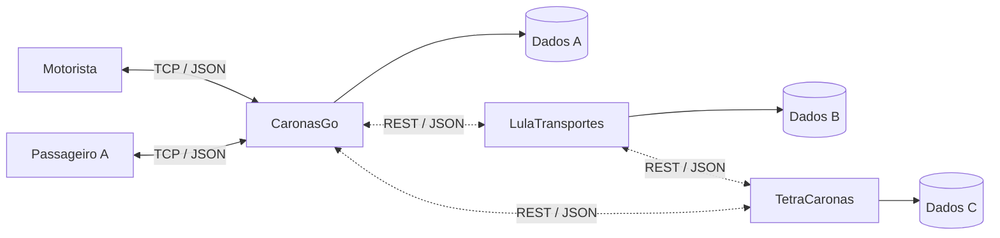

<div align="center">

# VaiJuntoAPP - Consórcio

**Caronas compartilhadas - TEC502**

Evolução distribuída do VaiJunto: empresas independentes, clientes de terminal em Go e execução isolada com Docker.

[Começar](#executar-com-docker) · [Como usar](#como-usar) · [Protocolo](#protocolo-de-comunicacao) · [Testes](#testes)

</div>

---

## Sobre o projeto

O VaiJunto permite que motoristas publiquem caronas e que passageiros reservem viagens diretas ou com conexão. Uma rota é dividida em trechos entre cidades consecutivas; cada trecho possui preço, duração e quantidade de assentos disponíveis.

Cada empresa executa seu próprio servidor e mantém usuários, caronas, reservas e logs em armazenamento exclusivo. Os clientes continuam se comunicando por TCP com o servidor de sua empresa. Pela API REST, os servidores identificam os pares, detectam indisponibilidade e consultam os catálogos de trechos para montar itinerários distribuídos.

| Componente | Responsabilidade |
| --- | --- |
| Servidor de empresa | Autenticar usuários locais, controlar caronas e vagas próprias e manter armazenamento isolado |
| Motorista | Criar conta, publicar caronas, consultar caronas e passageiros, cancelar caronas |
| Passageiro | Criar conta, buscar corridas, escolher uma data, reservar e cancelar reservas |

## Índice

- [Arquitetura](#arquitetura)
- [Requisitos e pacotes](#requisitos-e-pacotes)
- [Estrutura de diretórios](#estrutura-de-diretorios)
- [Executar com Docker](#executar-com-docker)
- [Executar no Windows ou pelo código-fonte](#executar-no-windows-ou-pelo-codigo-fonte)
- [Como usar](#como-usar)
- [Regras de funcionamento](#regras-de-funcionamento)
- [Persistência e logs](#persistencia-e-logs)
- [Configuração](#configuracao)
- [API REST entre empresas](docs/API_REST.md)
- [Protocolo de comunicação](#protocolo-de-comunicacao)
- [Testes](#testes)
- [Simulador de carga e falhas](docs/SIMULADOR.md)
- [Problemas comuns](#problemas-comuns)
- [Limitações do protótipo](#limitacoes-do-prototipo)

<a id="arquitetura"></a>
## Arquitetura



Motorista e passageiro acessam exclusivamente o servidor da empresa em que estão cadastrados. Não existe armazenamento compartilhado entre as empresas. O `compose.yaml` inicia três instâncias com volumes e portas diferentes.

Cada conexão aceita pelo servidor é atendida por uma goroutine. Reservas locais são protegidas por `sync.Mutex`. Nas viagens multiempresa, o servidor do passageiro coordena uma transação em duas fases: todas as empresas precisam preparar seus trechos antes da confirmação. Se uma delas recusar, as preparações anteriores são desfeitas.

<a id="requisitos-e-pacotes"></a>
## Requisitos e pacotes

| Forma de execução | Requisitos |
| --- | --- |
| Docker | Docker Engine/Desktop funcionando e Docker Compose v2 (`docker compose`) |
| Código-fonte | Go 1.22 ou superior, conforme `go.mod` |
| Executáveis Windows | Programas compilados em `bin/`; Go não é necessário para executá-los |
| Máquinas diferentes | Acesso de rede e portas configuradas para cada empresa |

No Windows, a execução dos contêineres Linux depende do backend configurado no Docker Desktop, como o WSL 2. A primeira construção das imagens precisa de acesso ao registro de imagens. XAMPP e Apache não são necessários.

### Bibliotecas utilizadas

Não existem dependências Go externas nem etapa de instalação com `go get`. Principais pacotes da biblioteca padrão:

| Pacote | Uso no projeto |
| --- | --- |
| `net` | Conexões e servidor TCP |
| `encoding/json` | Serialização das mensagens e dos arquivos de dados |
| `sync` e `sync/atomic` | Exclusão mútua e identificação de requisições |
| `crypto/rand`, `crypto/sha256` e `encoding/hex` | Tokens e representação dos hashes de senha |
| `os` e `path/filepath` | Arquivos, diretórios e variáveis de ambiente |
| `time` | Datas, horários, duração dos trechos e medições |
| `fmt`, `bufio`, `strings` e `strconv` | Interface de terminal, leitura e conversão de valores |
| `log` e `io` | Registros e operações de entrada/saída |
| `sort` | Ordenação das consultas |
| `testing` | Testes automatizados |

<a id="estrutura-de-diretorios"></a>
## Estrutura de diretórios

```text
vaijunto-parte-2/
├── cliente/                 # Cliente passageiro
├── motorista/               # Cliente motorista
├── servidor/                # Regras, rede, persistência e testes
├── simulador/               # Carga concorrente, métricas e injeção de falhas
├── preparador/              # Publicação idempotente do cenário de demonstração
├── comum/                   # Modelos e protocolo compartilhados
├── scripts/                 # Preparação e validação da entrega
├── terminal/                # Leitura e formatação dos menus
├── bin/                     # Executáveis do Windows
├── dados/
│   ├── empresa-a/           # Usuários e estado exclusivos da CaronasGo
│   ├── empresa-b/           # Usuários e estado exclusivos da LulaTransportes
│   └── empresa-c/           # Usuários e estado exclusivos da TetraCaronas
├── logs/                    # Um subdiretório por empresa
├── docs/
│   └── API_REST.md          # Contrato atual da comunicação entre servidores
├── Dockerfile.servidor
├── Dockerfile.motorista
├── Dockerfile.cliente
├── Dockerfile.simulador
├── Dockerfile.preparador
├── compose.yaml
├── go.mod
├── iniciar.bat              # Inicia o servidor no Windows
├── motorista.bat            # Inicia o motorista no Windows
├── cliente.bat              # Inicia o passageiro no Windows
├── compilar.bat             # Compila os executáveis do Windows
├── README.md                # Guia de uso e protocolo completo
└── DOCKER.md                # Guia complementar de rede
```

Os arquivos JSON e de log são criados pelo servidor quando necessário.

| Arquivo do servidor | Responsabilidade |
| --- | --- |
| `main.go` | Configuração, carregamento dos dados e abertura da porta |
| `configuracao.go` | Identidade, caminhos e isolamento de cada empresa |
| `rede.go` | Recebimento dos pedidos e envio das respostas |
| `estrutura.go` | Mapas, contadores e mutex |
| `autenticacao.go` | Cadastro, login e sessões |
| `caronas.go` | Publicação, consultas e cancelamento de caronas |
| `busca.go` | Grafo de trechos e montagem dos itinerários |
| `reservas.go` | Confirmação e cancelamento de reservas |
| `usuarios_json.go` | Persistência das contas |
| `estado_json.go` | Persistência das caronas e reservas |
| `auxiliares.go` | Normalização de cidades e cópias de dados |

<a id="executar-com-docker"></a>
## Executar com Docker

Abra um terminal na raiz de `vaijunto-parte-2`. O endereço do novo repositório remoto será incluído após sua criação no GitHub.

Confira se `docker version` mostra as seções **Client** e **Server**. As empresas publicam TCP em `9001`-`9003` e REST em `8081`-`8083`.

### 1. Construir as imagens e iniciar as empresas

```sh
docker compose build
docker compose up -d empresa-a empresa-b empresa-c
docker compose ps
```

Cada serviço possui identidade, volume de dados e volume de logs próprios.

### 2. Abrir o motorista

Em outro terminal, na mesma pasta:

```sh
docker compose run --rm --no-deps motorista
```

### 3. Abrir o passageiro

Em um terceiro terminal:

```sh
docker compose run --rm --no-deps cliente
```

Os clientes precisam de terminais interativos. Nesta etapa, os clientes definidos no Compose pertencem à CaronasGo e usam `empresa-a:9000`.

### Preparar o cenário distribuído da apresentação

O comando abaixo inicia as empresas, aguarda as APIs e publica um trecho em cada empresa. As três ofertas coexistem e seus horários são encadeados para formar `Salvador → Feira de Santana → Vitória da Conquista → Montes Claros`:

```powershell
.\scripts\preparar-demonstracao.ps1 -Data "2026-11-05"
```

O preparador reutiliza uma carona idêntica que ainda esteja totalmente disponível; assim, repetir o comando não cria duplicatas desnecessárias.

Para executar automaticamente a disputa simultânea, a queda da LulaTransportes, sua recuperação e o diagnóstico final:

```powershell
.\scripts\testar-docker-completo.ps1 -Data "2026-11-05"
```

### Comandos úteis

| Comando | Resultado |
| --- | --- |
| `docker compose ps` | Mostra os serviços em execução |
| `docker compose logs -f empresa-a` | Acompanha os eventos da CaronasGo |
| `docker compose restart empresa-b` | Reinicia somente a LulaTransportes |
| `docker compose stop motorista cliente` | Para clientes iniciados como serviços em segundo plano |
| `docker compose down` | Encerra e remove os serviços do Compose e sua rede |

Encerre os clientes interativos pela opção `0`. Depois de reiniciar o servidor, abra novamente os clientes e faça login. Os diretórios locais `dados/` e `logs/` permanecem no computador após `docker compose down`.

### O que os Dockerfiles fazem

| Etapa | Configuração atual |
| --- | --- |
| Compilação | Imagem `golang:1.27-alpine` |
| Arquivos copiados | `go.mod` e os pacotes necessários a cada componente |
| Construção do programa | `CGO_ENABLED=0 go build` |
| Execução | Imagem `alpine:3.22`, contendo o executável compilado |
| Inicialização | `ENTRYPOINT` específico para servidor, motorista ou passageiro |
| Portas do servidor | `EXPOSE 9000 8080`; o Compose publica TCP em `9001`-`9003` e REST em `8081`-`8083` |
| Persistência | Cada empresa monta seus próprios diretórios em `/app/dados` e `/app/logs` |

Não há bibliotecas externas a instalar. O compilador fica na etapa de construção; a imagem final contém apenas o ambiente de execução e o binário.

<a id="executar-no-windows-ou-pelo-codigo-fonte"></a>
## Executar no Windows ou pelo código-fonte

### Executáveis e atalhos

Na pasta do projeto, execute cada comando em um terminal separado:

| Componente | PowerShell |
| --- | --- |
| Servidor | `.\iniciar.bat` |
| Motorista | `.\motorista.bat` |
| Passageiro | `.\cliente.bat` |

Os atalhos executam os programas da pasta `bin/`. Depois de alterar o código, recompile antes de usá-los:

```powershell
.\compilar.bat
```

### Execução direta com Go

Execute o servidor primeiro e os clientes em terminais separados:

```sh
go run ./servidor
```

```sh
go run ./motorista
```

```sh
go run ./cliente
```

Os clientes usam `127.0.0.1:9000` por padrão. Execute os comandos na raiz do projeto para manter os caminhos de dados e logs consistentes.

<a id="como-usar"></a>
## Como usar

### Cadastro e login

Antes do login, a opção `1` permite entrar e a opção `2` permite criar uma conta. Informe nome, usuário e senha. O nome pode se repetir; o usuário de acesso deve ser único. Após o cadastro, o cliente realiza o login automaticamente.

| Campo | Regra atual |
| --- | --- |
| Nome | Pelo menos 2 caracteres após remover espaços das extremidades |
| Usuário | Pelo menos 3 caracteres, sem espaços; convertido para minúsculas |
| Senha | Pelo menos 4 caracteres |
| Perfil | Definido pelo cliente: `motorista` ou `passageiro` |

Contas iniciais de demonstração, quando o arquivo de usuários é criado:

| Perfil | Usuário | Senha |
| --- | --- | --- |
| Motorista | `motorista` | `1234` |
| Passageiro | `cliente` | `1234` |

### Menu do motorista

| Opção | Ação |
| --- | --- |
| `1` | Sair da conta |
| `2` | Publicar carona |
| `3` | Consultar minhas caronas |
| `4` | Consultar passageiros de uma carona |
| `5` | Cancelar carona |
| `0` | Encerrar o programa |

Para publicar, informe a quantidade de cidades e a rota na ordem da viagem. Para cada par de cidades consecutivas, informe preço e duração em minutos. Em seguida, informe data no formato `DD/MM/AAAA`, horário `HH:MM` e quantidade de assentos.

### Menu do passageiro

| Opção | Ação |
| --- | --- |
| `1` | Sair da conta |
| `2` | Buscar corrida e reservar |
| `3` | Consultar minhas reservas |
| `4` | Cancelar reserva |
| `0` | Encerrar o programa |

Na busca, informe origem e destino, escolha uma das datas exibidas e selecione uma corrida pelo número. Confira preço, horários, conexões, vagas e a empresa responsável por cada trecho. A consulta não bloqueia um assento. Se algum par não responder, o cliente avisa que o resultado é parcial e mantém as opções que não dependem dele.

### Exemplo de demonstração

1. O motorista publica `Feira de Santana → Salvador`, com 2 assentos, preço de R$ 35,00 e duração de 70 minutos.
2. O passageiro busca essas cidades, escolhe a data e confirma a reserva.
3. O motorista consulta a carona: o trecho deve ter 1 assento disponível.
4. O passageiro cancela a reserva: o trecho volta a ter 2 assentos.
5. Para testar uma conexão, publique também `Salvador → Lauro de Freitas`, com partida pelo menos 10 minutos depois da chegada da primeira carona, na mesma data.
6. Busque `Feira de Santana → Lauro de Freitas` para encontrar o itinerário combinado.

<a id="regras-de-funcionamento"></a>
## Regras de funcionamento

| Regra | Comportamento |
| --- | --- |
| Rota | Pelo menos duas cidades não vazias, sem repetição |
| Trechos | Cada posição liga duas cidades consecutivas da rota |
| Assentos | Quantidade inicial maior que zero; disponibilidade independente por trecho |
| Preço | Não negativo, representado por inteiro em centavos |
| Duração | Pelo menos um minuto por trecho |
| Conexão | Intervalo mínimo de 10 minutos quando há troca de carona |
| Busca | Evita ciclos; explora até 8 trechos e até 60 caminhos por data; retorna no máximo 20 opções |
| Ordenação | Horário de saída, preço e número de conexões |
| Reserva | Confirma todos os trechos juntos ou não confirma nenhum |
| Cancelamento do passageiro | Devolve os assentos de todos os trechos da reserva |
| Cancelamento do motorista | Cancela a carona e as reservas completas que a utilizam; devolve vagas dos demais trechos envolvidos |

Os nomes das cidades são comparados ignorando maiúsculas/minúsculas e espaços nas extremidades. Abreviações não são traduzidas: `FSA` e `Feira de Santana` são nomes diferentes para a busca.

<a id="persistencia-e-logs"></a>
## Persistência e logs

| Arquivo | Conteúdo | Sobrevive à reinicialização? |
| --- | --- | --- |
| `dados/<empresa_id>/usuarios.json` | Contas exclusivas da empresa | Sim |
| `dados/<empresa_id>/estado.json` | Caronas, reservas, vagas e identidade da empresa | Sim |
| `logs/<empresa_id>/servidor.log` | Eventos exclusivos da instância | Sim |
| Apenas em memória | Sessões, tokens e resultados temporários de busca `ITI` | Não |

Caronas, reservas e estados das transações participantes são gravados juntos em `estado.json`, dentro do controle de concorrência do servidor. O código escreve um arquivo temporário antes de substituir o arquivo de estado. Preparações sobrevivem à reinicialização e possuem prazo para não manter assentos bloqueados indefinidamente.

O mecanismo atual remove o arquivo anterior antes da renomeação; portanto, ainda existe uma janela de perda em caso de interrupção nesse intervalo. Ele não oferece garantia de recuperação contra queda de energia. Para preservar uma demonstração, faça uma cópia da pasta `dados/` com o servidor parado. Não edite os JSON enquanto o servidor estiver rodando.

O Compose monta as pastas locais no contêiner. Ao recriá-lo no mesmo projeto, o servidor carrega os dados salvos. Para usar esses mesmos dados em outro computador, é necessário levar também a pasta `dados/`.

Os logs registram conexões, cadastros, tentativas de login, buscas, publicações, reservas, cancelamentos e erros do protocolo. Senhas, hashes e tokens não são incluídos nos registros.

<a id="configuracao"></a>
## Configuração

| Variável | Componente | Valor padrão | Finalidade |
| --- | --- | --- | --- |
| `VAIJUNTO_ADDR` | Servidor | `:9000` | Endereço de escuta TCP |
| `VAIJUNTO_REST_ADDR` | Servidor | `:8080` | Endereço da API REST entre empresas |
| `VAIJUNTO_REST_TIMEOUT` | Servidor | `2s` | Timeout de cada chamada REST |
| `VAIJUNTO_PARES` | Servidor | vazio | Pares no formato `id=http://host:porta` separados por vírgula |
| `VAIJUNTO_SERVER` | Clientes | `127.0.0.1:9000` | Endereço da própria empresa; no Compose atual, `empresa-a:9000` |
| `VAIJUNTO_EMPRESA_ID` | Servidor | `vaijunto` | ID estável da empresa, em minúsculas e sem espaços |
| `VAIJUNTO_EMPRESA_NOME` | Servidor | `VaiJunto` | Nome exibido da empresa |
| `VAIJUNTO_DADOS_DIR` | Servidor | `dados/<empresa_id>` | Diretório exclusivo de dados |
| `VAIJUNTO_LOGS_DIR` | Servidor | `logs/<empresa_id>` | Diretório exclusivo de logs |
| `VAIJUNTO_USUARIOS` | Servidor | `<dados>/usuarios.json` | Sobrescreve o caminho das contas |
| `VAIJUNTO_ESTADO` | Servidor | `<dados>/estado.json` | Sobrescreve o caminho de caronas e reservas |
| `VAIJUNTO_LOG` | Servidor | `<logs>/servidor.log` | Sobrescreve o caminho do log |

Os caminhos relativos usam o diretório de execução do processo; no contêiner do servidor, ele é `/app`. Para personalizar variáveis no Docker, passe `-e` no `docker run` ou configure `environment` no Compose. Alterar a porta de escuta também exige ajustar a publicação de portas e o endereço dos clientes.

<a id="protocolo-de-comunicacao"></a>
## Protocolo de comunicação

Esta seção contém a documentação completa do protocolo. As estruturas implementadas estão em [`comum/protocolo.go`](comum/protocolo.go) e [`comum/modelos.go`](comum/modelos.go); o tratamento das operações fica em [`servidor/rede.go`](servidor/rede.go).

### Transporte e ciclo da conexão

| Item | Definição |
| --- | --- |
| Transporte | Socket TCP, porta padrão `9000` |
| Representação | Objetos JSON em UTF-8 |
| Delimitação | O emissor adiciona uma quebra de linha após cada objeto; o receptor lê um objeto JSON completo por vez |
| Correlação | A resposta repete o `id` do pedido |
| Autenticação | Token obtido por `login` e enviado nas operações autenticadas |
| Data | O usuário digita `20/09/2026`. No JSON, a data é enviada como `2026-09-20`. |
| Horário | Digitado como `08:00`. Nos trechos, o JSON guarda a data junto com o horário de saída e chegada. |
| Valores monetários | Inteiros em centavos: `3500` representa R$ 35,00 |

TCP é um fluxo de bytes: uma leitura de rede pode conter parte de uma mensagem ou várias mensagens. Um cliente em outra linguagem deve reconstruir objetos completos, sem assumir que uma chamada de leitura equivale a um pedido.

1. O cliente abre o socket; a tentativa inicial possui timeout de 5 segundos.
2. Envia `cadastro`, se necessário, e `login`.
3. Guarda o token e o envia nos próximos pedidos.
4. Envia um pedido, lê sua resposta e pode continuar usando a mesma conexão.
5. Ao encerrar, fecha o socket. Não existe operação de desconexão no protocolo.

O cadastro não devolve token: o login automático da interface é uma segunda requisição. Sair da conta limpa as credenciais no cliente, sem uma mensagem de revogação no servidor. Fechar ou perder uma conexão encerra o atendimento daquele cliente; reservas já concluídas permanecem registradas. Após reiniciar o servidor, é necessário abrir nova conexão, autenticar e repetir buscas pendentes.

### Envelope dos pedidos

```json
{"id":"REQ-1","acao":"login","dados":{"usuario":"motorista","senha":"1234"}}
```

| Campo | Tipo | Obrigatório | Descrição |
| --- | --- | --- | --- |
| `id` | string | Sim | Identificador não vazio; clientes Go usam `REQ-1`, `REQ-2` etc. |
| `acao` | string | Sim | Nome de uma operação suportada |
| `token` | string | Nas operações autenticadas | Token recebido no login |
| `dados` | objeto | Conforme a operação | Parâmetros; pode ser omitido ou `null` nas consultas sem parâmetros |

### Envelope das respostas

```json
{"id":"REQ-1","sucesso":true,"mensagem":"login realizado","dados":{"token":"TOKEN_EXEMPLO","nome":"João Motorista","perfil":"motorista"}}
```

| Campo | Tipo | Descrição |
| --- | --- | --- |
| `id` | string | Identificador do pedido; vazio quando o JSON não pôde ser interpretado |
| `sucesso` | boolean | Indica se a operação foi aceita |
| `mensagem` | string | Descrição do resultado ou do erro |
| `dados` | objeto ou array | Resultado, quando houver; omitido nas respostas sem dados |

### Operações e campos de entrada

| Ação | Dados enviados | Resultado em `dados` |
| --- | --- | --- |
| `cadastro` | `nome`, `usuario`, `senha`, `perfil`: strings | Omitido |
| `login` | `usuario`, `senha`: strings | Objeto com `token`, `nome`, `perfil` |
| `publicar_carona` | `rota`: string[]; `data`, `horario`: strings; `assentos`: inteiro; `precos_centavos`, `duracoes_min`: inteiro[] | Objeto Carona |
| `listar_caronas` | Sem parâmetros | Array de Carona do motorista, incluindo canceladas |
| `listar_passageiros` | `id`: string com código `CAR` | Array de Reserva confirmada que utiliza a carona |
| `cancelar_carona` | `id`: string com código `CAR` | Omitido |
| `buscar_itinerarios` | `origem`, `destino`: strings; `data`: string opcional | Resultado com itinerários, indicador de busca parcial e empresas indisponíveis |
| `confirmar_reserva` | `id`: string com código `ITI` | Objeto Reserva |
| `listar_reservas` | Sem parâmetros | Array de Reserva do passageiro, incluindo canceladas |
| `cancelar_reserva` | `id`: string com código `RES` | Omitido |

`cadastro` e `login` são públicos. Publicação e listagem de caronas exigem perfil de motorista; busca e listagem de reservas exigem passageiro. As demais operações verificam a sessão e a propriedade da carona, reserva ou busca indicada. Um itinerário só pode ser confirmado pelo usuário que o obteve, uma única vez.

Na publicação, `precos_centavos` e `duracoes_min` devem ter exatamente `len(rota) - 1` elementos. `assentos` deve ser positivo, preços não negativos e durações positivas. Datas e horários devem respeitar os formatos descritos acima.

Na busca, omitir `data` ou enviar `""` consulta as datas disponíveis em todas as empresas alcançáveis. A interface permite selecionar uma data entre os resultados recebidos. Uma busca vazia é bem-sucedida com `itinerarios: []`.

### Exemplos de requisições

Cada linha abaixo é uma mensagem independente. Substitua os tokens pelos recebidos no login e os códigos pelos retornados pelo servidor.

```json
{"id":"REQ-1","acao":"cadastro","dados":{"nome":"Ana Silva","usuario":"ana","senha":"1234","perfil":"passageiro"}}
{"id":"REQ-2","acao":"login","dados":{"usuario":"ana","senha":"1234"}}
{"id":"REQ-3","acao":"publicar_carona","token":"TOKEN_MOTORISTA","dados":{"rota":["Feira de Santana","Salvador"],"data":"2026-09-20","horario":"08:00","assentos":2,"precos_centavos":[3500],"duracoes_min":[70]}}
{"id":"REQ-4","acao":"listar_caronas","token":"TOKEN_MOTORISTA"}
{"id":"REQ-5","acao":"listar_passageiros","token":"TOKEN_MOTORISTA","dados":{"id":"CAR-001"}}
{"id":"REQ-6","acao":"buscar_itinerarios","token":"TOKEN_PASSAGEIRO","dados":{"origem":"Feira de Santana","destino":"Salvador","data":"2026-09-20"}}
{"id":"REQ-7","acao":"confirmar_reserva","token":"TOKEN_PASSAGEIRO","dados":{"id":"ITI-001"}}
{"id":"REQ-8","acao":"listar_reservas","token":"TOKEN_PASSAGEIRO"}
{"id":"REQ-9","acao":"cancelar_reserva","token":"TOKEN_PASSAGEIRO","dados":{"id":"RES-001"}}
{"id":"REQ-10","acao":"cancelar_carona","token":"TOKEN_MOTORISTA","dados":{"id":"CAR-001"}}
```

### Modelos retornados

#### Carona

| Campo | Tipo | Significado |
| --- | --- | --- |
| `id`, `motorista` | string | Código `CAR` e usuário do motorista |
| `rota` | string[] | Cidades na ordem da viagem |
| `data`, `horario` | string | Data e horário inicial |
| `assentos` | inteiro | Capacidade inicial de cada trecho |
| `precos_centavos` | inteiro[] | Preço de cada trecho |
| `duracoes_min` | inteiro[] | Duração de cada trecho |
| `disponiveis_por_trecho` | inteiro[] | Quantidade atual de vagas por trecho |
| `cancelada` | boolean | Indica cancelamento da carona |

Resposta de publicação:

```json
{"id":"REQ-3","sucesso":true,"mensagem":"carona publicada","dados":{"id":"CAR-001","motorista":"motorista","rota":["Feira de Santana","Salvador"],"data":"2026-09-20","horario":"08:00","assentos":2,"precos_centavos":[3500],"duracoes_min":[70],"disponiveis_por_trecho":[2],"cancelada":false}}
```

`listar_caronas` retorna esses mesmos objetos dentro de um array, com mensagem `caronas encontradas`.

#### Trecho e itinerário

| Campo de Trecho | Tipo | Significado |
| --- | --- | --- |
| `empresa_id` | string | Empresa responsável pela carona e pelos assentos |
| `carona_id` | string | Carona responsável pelo trecho |
| `indice` | inteiro | Posição do trecho na rota, começando em zero |
| `motorista` | string | Usuário do motorista |
| `origem`, `destino` | string | Cidades do trecho |
| `saida`, `chegada` | string RFC 3339 | Instantes calculados pelo servidor |
| `preco_centavos` | inteiro | Preço do trecho |

| Campo de Itinerário | Tipo | Significado |
| --- | --- | --- |
| `id` | string | Código temporário `ITI` |
| `origem`, `destino`, `data` | string | Parâmetros da viagem |
| `preco_centavos` | inteiro | Soma dos preços dos trechos |
| `conexoes` | inteiro | Número de caronas distintas utilizadas menos um |
| `vagas` | inteiro | Menor disponibilidade entre os trechos no momento da busca |
| `trechos` | Trecho[] | Sequência de deslocamentos |

Exemplo de resposta de busca, com horários ilustrados em UTC:

```json
{
  "id": "REQ-6",
  "sucesso": true,
  "mensagem": "busca concluída",
  "dados": {
    "busca_parcial": false,
    "itinerarios": [{
    "id": "ITI-001",
    "origem": "Feira de Santana",
    "destino": "Salvador",
    "data": "2026-09-20",
    "preco_centavos": 3500,
    "conexoes": 0,
    "vagas": 2,
    "trechos": [{
      "empresa_id": "empresa-a",
      "carona_id": "CAR-001",
      "indice": 0,
      "motorista": "motorista",
      "origem": "Feira de Santana",
      "destino": "Salvador",
      "saida": "2026-09-20T08:00:00Z",
      "chegada": "2026-09-20T09:10:00Z",
      "preco_centavos": 3500
    }]
    }],
    "empresas_indisponiveis": []
  }
}
```

O servidor interpreta a data e o horário no fuso local do processo. Os exemplos usam `Z`, mas o valor real pode conter outro deslocamento. Os clientes exibem os horários recebidos.

#### Reserva

| Campo | Tipo | Significado |
| --- | --- | --- |
| `id` | string | Código `RES` |
| `transacao_id` | string | Identificador da transação quando a reserva envolve outras empresas |
| `passageiro`, `nome_passageiro` | string | Usuário e nome do passageiro |
| `status` | string | `confirmada`, `cancelada pelo passageiro` ou `cancelada pelo motorista` |
| `criada_em` | string RFC 3339 | Instante da confirmação |
| `itinerario` | Itinerário | Cópia do itinerário reservado |

Resposta de confirmação:

```json
{
  "id": "REQ-7",
  "sucesso": true,
  "mensagem": "reserva confirmada",
  "dados": {
    "id": "RES-001",
    "passageiro": "ana",
    "nome_passageiro": "Ana Silva",
    "status": "confirmada",
    "criada_em": "2026-09-19T14:00:00Z",
    "itinerario": {
      "id": "ITI-001",
      "origem": "Feira de Santana",
      "destino": "Salvador",
      "data": "2026-09-20",
      "preco_centavos": 3500,
      "conexoes": 0,
      "vagas": 1,
      "trechos": [{
        "carona_id": "CAR-001",
        "indice": 0,
        "motorista": "motorista",
        "origem": "Feira de Santana",
        "destino": "Salvador",
        "saida": "2026-09-20T08:00:00Z",
        "chegada": "2026-09-20T09:10:00Z",
        "preco_centavos": 3500
      }]
    }
  }
}
```

`listar_reservas` retorna um array desse modelo com mensagem `reservas encontradas`. `listar_passageiros` retorna um array de reservas confirmadas que utilizam a carona consultada, com mensagem `passageiros encontrados`. A resposta inclui o itinerário inteiro; para identificar os trechos daquela carona, filtre `itinerario.trechos` por `carona_id`.

O campo `vagas` do itinerário é uma informação de consulta, não uma contagem continuamente atualizada. A confirmação valida os assentos reais dos trechos, independentemente do valor exibido anteriormente.

### Respostas sem dados e erros

```json
{"id":"REQ-1","sucesso":true,"mensagem":"conta criada com sucesso"}
{"id":"REQ-9","sucesso":true,"mensagem":"reserva cancelada"}
{"id":"REQ-10","sucesso":true,"mensagem":"carona cancelada"}
{"id":"REQ-6","sucesso":true,"mensagem":"busca concluída","dados":{"itinerarios":[],"busca_parcial":false}}
{"id":"REQ-2","sucesso":false,"mensagem":"usuário ou senha incorretos"}
{"id":"REQ-7","sucesso":false,"mensagem":"um dos trechos ficou sem assento"}
{"id":"REQ-11","sucesso":false,"mensagem":"operação desconhecida"}
{"id":"","sucesso":false,"mensagem":"mensagem JSON inválida"}
```

| Situação | Comportamento |
| --- | --- |
| `id` ou `acao` vazio | Erro `id e acao são obrigatórios` |
| JSON malformado ou envelope com tipo incompatível | Tenta enviar erro e fecha somente aquela conexão |
| Dados ausentes ou tipos inválidos | Resposta de erro da operação |
| Token inválido | Erro `faça login antes de continuar` |
| Ação desconhecida | Resposta de erro, mantendo a conexão |
| Carona ou reserva de outro usuário | Operação recusada |
| Trecho indisponível na confirmação | O coordenador aborta todos os participantes já preparados |
| Dois passageiros disputam o último assento | O servidor dono do trecho aceita somente a primeira preparação que processar |
| Preparação abandonada | O assento é liberado automaticamente ao vencer o prazo local |
| Coordenador cai entre confirmações | Ao reiniciar, recupera a decisão durável e retoma os participantes |
| Resposta de `commit` é perdida | Consulta o estado do participante antes de repetir |
| Preparação expira durante a queda | Compensa os trechos já confirmados e termina sem reserva parcial |
| Falha ao persistir uma alteração | Operação retorna erro |

Os nomes dos campos e as ações são sensíveis à grafia. Campos desconhecidos são ignorados pelo decodificador atual. Os identificadores de requisição servem para correlação, não para deduplicação: repetir um pedido após perder a resposta não garante uma execução única. Consulte o estado antes de repetir uma operação cuja resposta foi perdida.

<a id="testes"></a>
## Testes

Na raiz do projeto, com Go instalado:

```sh
go vet ./...
go test -v ./...
```

| Cenário automatizado | Verificação |
| --- | --- |
| Busca sem data | Retorna corridas disponíveis em datas diferentes |
| Reserva e cancelamento | Desconta e devolve vagas |
| Itinerário com trecho lotado | Não confirma uma viagem pela metade |
| Cancelamento de carona | Cancela a reserva completa e devolve as vagas envolvidas |
| 30 clientes TCP concorrentes | Somente um consegue reservar o último assento |
| Persistência | Recupera caronas, reservas, vagas, cancelamentos e contador de caronas após reiniciar |
| Recuperação do coordenador | Retoma um `commit` interrompido entre duas empresas |
| Resposta REST perdida | Consulta o participante e não desconta o assento novamente |
| Preparação expirada | Compensa participantes confirmados e não mantém reserva parcial |
| 60 reservas distribuídas simultâneas | Confirma exatamente uma vez o último assento |
| Cadastro | Recupera usuários do JSON e não grava a senha em texto puro |
| Logs | Não registra senha nem token |

O teste de concorrência registra o tempo total do grupo de clientes, não percentis de latência por requisição. Para executá-lo isoladamente:

```sh
go test -v -run TestVariosClientesDisputamMesmoAssento ./servidor
```

O detector de condições de corrida pode ser executado em um ambiente Go com suporte a CGO e compilador C:

```sh
go test -race ./...
```

Os contêineres finais da aplicação não contêm o compilador Go. Para testar dentro de um contêiner de desenvolvimento Linux, no PowerShell ou Bash, a partir da raiz do projeto:

```sh
docker run --rm -v "${PWD}:/projeto:ro" -w /projeto golang:1.27 sh -c "go vet ./... && go test -race -v ./..."
```

Esse comando usa uma imagem de desenvolvimento diferente da imagem Alpine final da aplicação. O diretório do projeto é montado somente para leitura; os testes criam seus dados em diretórios temporários.

### Conferência manual da persistência

1. Publique uma carona e confirme uma reserva.
2. Confira a disponibilidade pelo motorista.
3. Execute `docker compose restart empresa-a`.
4. Encerre os clientes antigos, abra-os novamente e faça login.
5. Consulte caronas e reservas; as vagas e os registros devem permanecer.

<a id="problemas-comuns"></a>
## Problemas comuns

| Sintoma | O que verificar |
| --- | --- |
| Docker não conecta ao Engine | Aguarde o Docker Desktop iniciar; confira `docker version` |
| Docker Desktop não inicia no Windows | Verifique o backend WSL 2 e reinicie o Windows após instalar os componentes necessários |
| Porta `9000` já está em uso | Encerre o servidor anterior antes de iniciar outra instância |
| Menus não aparecem | Abra os clientes com `docker compose run --rm --no-deps`, em terminais separados |
| Cliente não conecta | Confira se o servidor iniciou, IP, porta, firewall e acesso entre as máquinas |
| Não encontra uma corrida | Confira nomes das cidades, data, vagas, cancelamento e horários das conexões |
| Dados parecem ter desaparecido | Confira a pasta de execução, `VAIJUNTO_ESTADO` e o volume `dados/` |
| Erro de carregamento de JSON | Verifique se o arquivo foi editado ou corrompido; preserve uma cópia antes de tentar repará-lo |
| Cliente perde conexão após reinício | Feche o cliente, abra novamente e refaça o login |
| Alteração de código não aparece | Recompile os executáveis ou reconstrua a imagem Docker |

<a id="limitacoes-do-prototipo"></a>
## Limitações do protótipo

- A interface dos usuários é de terminal; a API REST atende somente à comunicação entre servidores.
- Busca, confirmação e cancelamento entre empresas estão implementados com preparação, confirmação, compensação e idempotência.
- A decisão do coordenador e os estados dos participantes sobrevivem à reinicialização; confirmações pendentes são retomadas ou compensadas automaticamente.
- O simulador autônomo gera carga nas três empresas, injeta falhas via Docker e produz relatórios JSON/CSV.
- A busca possui os limites descritos acima; as 20 opções retornadas não representam necessariamente todas as viagens existentes.
- A consulta atual do motorista mostra o itinerário completo da reserva, sem agrupar os passageiros por trecho na tela.
- O transporte não utiliza TLS e as senhas usam SHA-256 simples. São decisões de um protótipo acadêmico, não uma autenticação adequada para produção.
- A persistência em arquivos não possui recuperação transacional contra falhas de energia.
- Não há reconexão automática dos clientes nem revogação de sessão no logout.

---

Desenvolvido para a disciplina **TEC502**. As regras e mensagens documentadas correspondem à implementação presente neste repositório.
