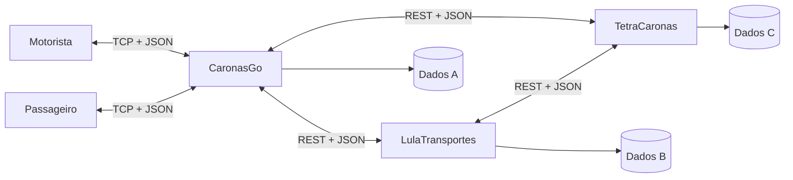
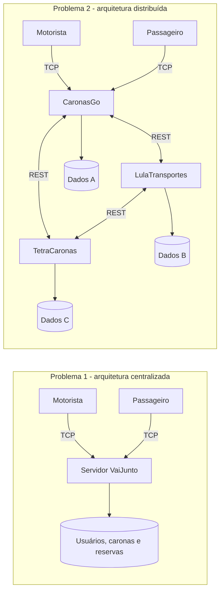
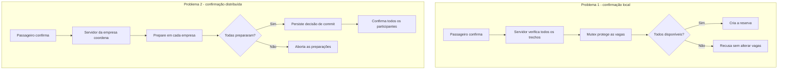

# VaiJunto - Consórcio de Caronas

Projeto desenvolvido para o Problema 2 da disciplina TEC502.

O sistema conecta empresas regionais de caronas sem usar servidor central ou banco de dados compartilhado. Cada empresa mantém seus usuários, caronas e reservas, mas coopera com as demais para buscar e confirmar viagens com vários trechos.

## Arquitetura

O projeto executa três empresas:

- CaronasGo (`empresa-a`)
- LulaTransportes (`empresa-b`)
- TetraCaronas (`empresa-c`)



Motoristas e passageiros se conectam apenas ao servidor da própria empresa. A comunicação com outras empresas é responsabilidade do servidor.

Cada instância possui:

- servidor TCP para os clientes;
- API REST para o consórcio;
- arquivos de dados e logs próprios;
- controle local dos assentos de suas caronas.

Não existe coordenador fixo. Em cada reserva, o servidor da empresa do passageiro assume temporariamente a coordenação.

## Problema 1 x Problema 2

No Problema 1, usuários, caronas e reservas ficavam em um único servidor. A segunda etapa distribui esses dados entre empresas independentes e permite montar uma viagem com trechos de todas elas.

### Mudança de arquitetura



| Aspecto | Problema 1 | Problema 2 |
|---|---|---|
| Organização | Um servidor central | Três servidores independentes |
| Dados | Um estado compartilhado por todos | Cada empresa mantém apenas seus dados |
| Cliente | Conecta ao servidor central | Conecta somente à própria empresa |
| Comunicação | TCP entre cliente e servidor | TCP com clientes e REST entre empresas |
| Busca | Consulta somente a memória local | Combina catálogos recebidos dos pares |
| Reserva | Operação local protegida por mutex | Transação distribuída em duas fases |
| Coordenador | O próprio servidor central | Servidor do passageiro, escolhido por reserva |
| Precedência | Ordem processada pelo mutex central | Ordem processada pelo proprietário do assento |
| Falha | Pode interromper toda a plataforma | Afeta apenas operações dependentes da empresa caída |
| Recuperação | Recarrega um único estado | Reconcilia decisões persistidas entre participantes |

### Mudança no fluxo da reserva



| Situação | Problema 1 | Problema 2 |
|---|---|---|
| Dois passageiros disputam a última vaga | O mutex central escolhe um vencedor | O servidor dono da carona escolhe um vencedor |
| Um trecho fica indisponível | A operação local é desfeita | O coordenador envia abort aos participantes |
| Servidor cai durante a reserva | A plataforma inteira fica indisponível | As empresas independentes continuam funcionando |
| Resposta se perde | O cliente pode consultar o servidor central | O coordenador consulta o estado da transação e repete com idempotência |
| Motorista cancela uma carona | O servidor altera a reserva local | O cancelamento é propagado e retomado após falhas |

O ganho da nova arquitetura é a independência entre as empresas. O custo é a necessidade de timeouts, idempotência, persistência das decisões e recuperação de transações incompletas.

## Funcionalidades

### Motorista

- criar conta e autenticar-se;
- publicar carona com rota, horário, assentos, duração e preço por trecho;
- consultar caronas e passageiros;
- cancelar uma carona.

Quando uma carona distribuída é cancelada, o coordenador invalida a reserva completa e devolve os assentos dos outros trechos. Se o coordenador estiver fora do ar, a invalidação é persistida e repetida após sua recuperação.

### Passageiro

- criar conta e autenticar-se;
- buscar viagens diretas ou com conexões;
- combinar trechos de empresas diferentes;
- confirmar todos os trechos de forma atômica;
- consultar e cancelar reservas.

Uma empresa indisponível produz uma busca parcial. As opções que não dependem dela continuam sendo exibidas.

## Reserva distribuída

A confirmação utiliza um protocolo em duas fases adaptado:

1. O coordenador separa os trechos por empresa.
2. Os participantes são preparados em ordem de ID.
3. Cada empresa verifica e bloqueia seus próprios assentos.
4. Se todas aceitarem, o coordenador persiste a decisão e envia o commit.
5. Se alguma recusar, as preparações anteriores são abortadas.

O servidor proprietário do trecho decide a precedência. A primeira preparação processada sob o mutex local recebe o último assento; relógios de máquinas diferentes não são comparados.

Preparações possuem prazo de expiração. As decisões do coordenador, os estados dos participantes e os cancelamentos pendentes são persistidos para permitir recuperação após uma queda.

As operações REST mutáveis exigem:

```text
Idempotency-Key: <transacao_id>
```

Repetir uma operação com a mesma transação não desconta ou devolve o assento novamente.

## Organização do projeto

```text
cliente/       cliente de terminal do passageiro
motorista/     cliente de terminal do motorista
servidor/      TCP, REST, regras, persistência e recuperação
comum/         modelos e mensagens compartilhadas
simulador/     carga concorrente, métricas e injeção de falhas
preparador/    criação do cenário distribuído de demonstração
terminal/      leitura e formatação dos menus
scripts/       preparação e validação automatizada
docs/          especificação da API e do simulador
```

Documentação técnica:

- [API REST entre empresas](docs/API_REST.md)
- [Simulador de carga e falhas](docs/SIMULADOR.md)
- [Roteiro de testes e demonstração em três máquinas](docs/roteiro_inicializacao.md)
- [Execução com Docker e rede](DOCKER.md)

## Requisitos

- Go 1.22 ou superior; ou
- Docker Engine/Desktop com Docker Compose v2.

O projeto utiliza apenas a biblioteca padrão do Go.

## Execução com Docker

Na raiz do projeto:

```powershell
docker compose build
docker compose up -d empresa-a empresa-b empresa-c
docker compose ps
```

Portas publicadas:

| Empresa | TCP | REST |
|---|---:|---:|
| CaronasGo | 9001 | 8081 |
| LulaTransportes | 9002 | 8082 |
| TetraCaronas | 9003 | 8083 |

Abrir o cliente do motorista:

```powershell
docker compose run --rm --no-deps motorista
```

Abrir o cliente do passageiro:

```powershell
docker compose run --rm --no-deps cliente
```

Encerrar os servidores:

```powershell
docker compose down
```

Os dados permanecem nas pastas locais `dados/` e `logs/`.

## Cenário de demonstração

O preparador publica três caronas compatíveis:

```text
Salvador
  -> Feira de Santana
  -> Vitória da Conquista
  -> Montes Claros
```

Cada trecho pertence a uma empresa diferente.

```powershell
.\scripts\preparar-demonstracao.ps1 -Data "2026-11-05"
```

O script completo prepara o cenário, disputa o último assento, derruba a LulaTransportes, restaura o servidor e verifica o estado final:

```powershell
.\scripts\testar-docker-completo.ps1 -Data "2026-11-05"
```

Os relatórios são gravados em `relatorios/` nos formatos JSON e CSV.

## Execução pelo código-fonte

Servidor:

```powershell
go run ./servidor
```

Motorista e passageiro, em terminais separados:

```powershell
go run ./motorista
go run ./cliente
```

Por padrão, os clientes usam `127.0.0.1:9000`. O endereço pode ser alterado com `VAIJUNTO_SERVER`.

Contas iniciais:

| Perfil | Usuário | Senha |
|---|---|---|
| Motorista | `motorista` | `1234` |
| Passageiro | `cliente` | `1234` |

## Configuração do servidor

| Variável | Padrão | Uso |
|---|---|---|
| `VAIJUNTO_ADDR` | `:9000` | endereço TCP |
| `VAIJUNTO_REST_ADDR` | `:8080` | endereço REST |
| `VAIJUNTO_REST_TIMEOUT` | `2s` | timeout entre empresas |
| `VAIJUNTO_PARES` | vazio | pares no formato `id=url` |
| `VAIJUNTO_EMPRESA_ID` | `vaijunto` | identificador da empresa |
| `VAIJUNTO_EMPRESA_NOME` | `VaiJunto` | nome exibido |
| `VAIJUNTO_DADOS_DIR` | `dados/<id>` | dados exclusivos |
| `VAIJUNTO_LOGS_DIR` | `logs/<id>` | logs exclusivos |

Exemplo de pares:

```text
empresa-b=http://empresa-b:8080,empresa-c=http://empresa-c:8080
```

## API REST

Principais recursos:

| Método | Recurso | Uso |
|---|---|---|
| `GET` | `/api/v1/health` | saúde da empresa |
| `GET` | `/api/v1/consortium/health` | saúde dos pares |
| `GET` | `/api/v1/rides/search` | catálogo de trechos locais |
| `POST` | `/api/v1/reservations/prepare` | preparar assentos |
| `POST` | `/api/v1/reservations/commit` | confirmar transação |
| `POST` | `/api/v1/reservations/abort` | desfazer transação |
| `POST` | `/api/v1/reservations/invalidate` | cancelar por decisão do motorista |
| `GET` | `/api/v1/reservations/status` | consultar transação |
| `GET` | `/api/v1/diagnostics/transactions` | diagnóstico agregado |

O contrato completo, exemplos e diagrama de sequência estão em [docs/API_REST.md](docs/API_REST.md).

## Testes

```powershell
go test ./...
go vet ./...
```

A suíte cobre, entre outros casos:

- disputa simultânea pelo último assento;
- reserva com três empresas;
- falha durante preparação e commit;
- recuperação do coordenador;
- expiração de bloqueios;
- resposta REST perdida;
- cancelamento distribuído do motorista;
- recuperação de cancelamento pendente;
- validação da chave de idempotência;
- persistência após reinicialização.

Para validar os arquivos e a configuração antes da apresentação:

```powershell
.\scripts\validar-entrega.ps1
```

## Persistência

Cada empresa mantém:

```text
dados/<empresa>/usuarios.json
dados/<empresa>/estado.json
logs/<empresa>/servidor.log
```

O estado inclui caronas, reservas, disponibilidade, transações e cancelamentos pendentes. Sessões e resultados temporários de busca permanecem apenas em memória.

## Limitações

- A interface é de terminal.
- A descoberta dos pares é configurada por variável de ambiente.
- A API REST não utiliza TLS nem autenticação entre empresas.
- As senhas usam SHA-256 simples, suficiente apenas para o protótipo acadêmico.
- A persistência em JSON não substitui um banco transacional.
- A queda de energia durante a troca do arquivo de estado ainda pode exigir recuperação manual.
